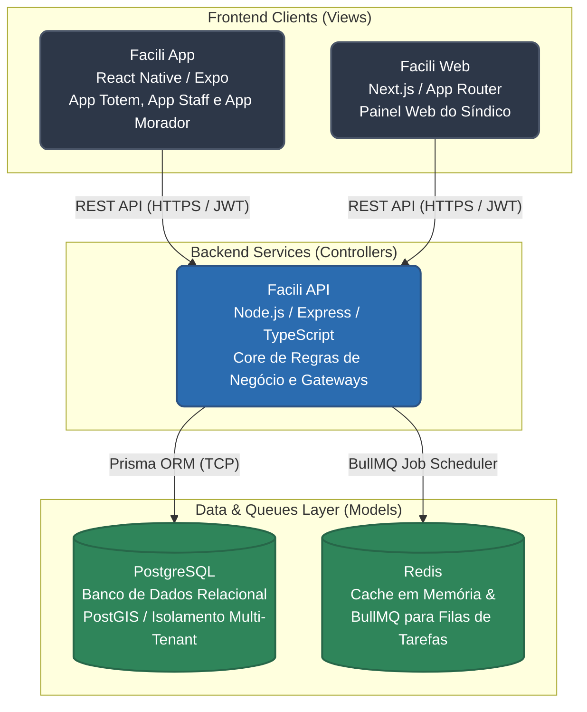

  
  # Facili - Mais que gestão, tranquilidade.
  
  **O ecossistema definitivo que resolve a desorganização de encomendas, a falta de transparência financeira e ruídos de comunicação no seu condomínio.**

  
  
  
  
  
  

   

---

## O Problema do Mundo Real

A administração de condomínios sofre cronicamente com o excesso de papelada, a falta de segurança nos controles de acesso e a comunicação fragmentada. Na prática, isso se traduz em:

- **Controles Paralelos e Informais:** Uso indiscriminado de grupos de WhatsApp para notificar ocorrências, gerando ruído, discussões e pulverizando dados importantes do condomínio.
- **Desorganização de Encomendas:** Extravios, moradores sem aviso de que o pacote chegou e falta de assinatura no momento da retirada.
- **Falta de Transparência Financeira:** Síndicos e moradores sem visibilidade clara sobre o fluxo de caixa, relatórios e inadimplência.
- **Dificuldade em Aplicar Regras:** Falta de rastreabilidade para o envio de multas e advertências por infrações.

## A Solução

O **FaciliCond** é um produto SaaS (Software as a Service) focado no segmento B2B (condomínios comerciais e residenciais) que ataca diretamente esses problemas operacionais. Ele integra uma tríade de aplicações:

1. **Painel do Síndico (Web):** Centro de controle gerencial, emissão de multas, advertências, relatórios financeiros e operacional.
2. **Totem de Autoatendimento:** Um kiosk digital que roda em tablets na portaria para registro rápido de entrada/saída de visitantes.
3. **App do Colaborador e Morador (Mobile):** Ferramenta no bolso para recebimento de encomendas via QR Code, acompanhamento de comunicados oficiais e abertura de ocorrências virtuais.

---

## Destaques de Engenharia (Engineering Highlights)

Como engenheiro responsável pela concepção e arquitetura deste sistema, estruturei a aplicação com foco na escalabilidade, segurança e integridade de dados críticos.

### 1. Isolamento Rigoroso de Dados (Multi-tenancy)
Por ser um SaaS atendendo a múltiplos condomínios simultaneamente no mesmo banco de dados, a arquitetura exige um isolamento perfeito dos tenants. 
- Implementei o modelo **Row-Level Security / Tenant ID**, onde a chave `condominioId` permeia todas as entidades principais do banco (PostgreSQL + Prisma ORM). 
- A camada de *Services / Repositories* assegura que nenhuma query vaze dados entre diferentes clientes, sendo o `condominioId` injetado diretamente pelo token JWT decodificado.

### 2. Autenticação Segura e Controle de Dispositivos (Kiosk Mode)
O Totem de portaria fica em um ambiente físico público e vulnerável. Para mitigar riscos:
- **Device Tokens:** O Totem não usa login humano tradicional. Ele é pareado uma única vez através de um token de dispositivo exclusivo (Device Access Token).
- **Kiosk Mode:** O aplicativo React Native (Expo) opera confinado na tela, impedindo que os usuários saiam do app e acessem o sistema operacional. Toda comunicação é cifrada e assinada.

### 3. Background Jobs e Resiliência Financeira
Para garantir que a API principal não sofra latência e continue respondendo em poucos milissegundos (sub-50ms):
- Rotinas pesadas (ex: disparos de e-mails emergenciais, consolidação de relatórios financeiros, notificações de multas) foram completamente extraídas do *Event Loop* principal do Node.js.
- Utilizei **Redis** acoplado ao **BullMQ** para criar uma estrutura resiliente de *Message Queuing* com políticas de retry automáticas.

### 4. Padrões de Projeto (MVC & SOLID)
- O backend está rigorosamente organizado seguindo o padrão MVC adaptado, com separação clara de responsabilidades: **Rotas (Routes) ➔ Controladores (Controllers) ➔ Filas (Queues)**.
- O uso de TypeScript strict garante previsibilidade em tempo de compilação, eliminando bugs silenciosos no tráfego de cargas dinâmicas.

---

## Arquitetura do Sistema

Abaixo o fluxograma de comunicação entre os clientes, a API Restful e os serviços de infraestrutura de dados:

---

## Stack Tecnológico

A escolha tecnológica foi guiada pela busca de estabilidade, tipagem forte e desenvolvimento rápido de um ecossistema multiplataforma (Web e Mobile).

### Frontend (Client-side)
- **Painel Administrativo & Financeiro:** Next.js 16 (App Router), React 19
- **Estilização (Web):** Tailwind CSS v4, Server Components
- **Mobile (Morador, Staff & Totem):** React Native, Expo SDK
- **Estilização (Mobile):** NativeWind v4 (Tailwind para React Native)

### Backend (Server-side)
- **Runtime:** Node.js (v20+ LTS)
- **Framework & Roteamento:** Express.js
- **Linguagem:** TypeScript Estrito (`--strict` mode)
- **Validação de Dados:** Zod (Schemas nas bordas da aplicação)

### Infraestrutura & Dados
- **Banco de Dados Relacional:** PostgreSQL
- **ORM / Query Builder:** Prisma ORM (com migrations versionadas)
- **Cache e Message Broker:** Redis
- **Background Jobs:** BullMQ
- **Containerização:** Docker e Docker Compose (para ambientes locais e CI)
